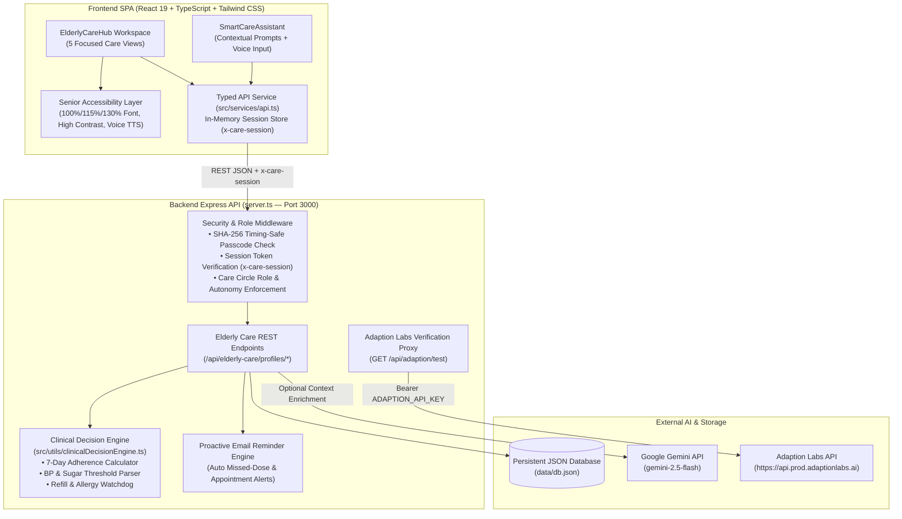

# SilverCare — Elderly Care & Medication Management Platform

**Live Deployment URL:** [https://ais-pre-bxytgppesah33psacacmdl-530948025475.asia-east1.run.app](https://ais-pre-bxytgppesah33psacacmdl-530948025475.asia-east1.run.app)  
**Alternate Preview URL:** [https://ais-pre-cefe6u3zggwfiu6fe5x5gk-530948025475.asia-east1.run.app](https://ais-pre-cefe6u3zggwfiu6fe5x5gk-530948025475.asia-east1.run.app)  
**Hackathon Track:** CATALYST — Solo AI Hackathon (Makers Need More × PromptWars)  
**Chosen Vertical:** Elderly Care & Medication Management Platform

---

## 1. Project Introduction

**SilverCare** is a smart, interconnected healthcare and medication management platform purpose-built to help elderly individuals manage their daily medications, medical appointments, vitals, and wellness routines while keeping their family members and caretakers informed in real time.

Instead of functioning as a passive alarm clock, SilverCare creates a collaborative **Care Circle ecosystem** protected by timing-safe passcode authentication and role-based permissions. It pairs a deterministic **Clinical Context Decision Engine** with **Google Gemini AI** (`@google/genai`), **Senior Autonomy Controls**, **Multilingual Voice Read-Aloud (`en-IN`, `hi-IN`, `mr-IN`)**, and **Proactive Email Escalation** so elderly individuals remain at the center of their own healthcare decisions.

---

## 2. Original Hackathon Problem Statement

> **Elderly Care & Medication Management Platform**  
> Develop a smart, interconnected healthcare management platform designed to help elderly individuals manage their daily medications, medical appointments, and healthcare routines while keeping their family members and caretakers informed.
>
> The platform should provide a shared ecosystem where elderly individuals, caretakers, and family members can access and manage an elderly person's healthcare profile through secure, passcode-based access. Authorized members should be able to view, add, edit, and manage medication schedules, track adherence, and monitor upcoming doctor appointments.
>
> The system should proactively send email reminders for missed medications, upcoming doses, and medical appointments, ensuring that important healthcare routines are never overlooked.
>
> The challenge is to go beyond a basic reminder application. Think creatively and develop innovative ways to make elderly care smarter, more accessible, reliable, and collaborative, while ensuring that elderly individuals remain at the centre of their own healthcare decisions.

---

## 3. Our Approach & Solution

SilverCare addresses every requirement of the problem statement through four tightly integrated pillars:

1. **Shared Passcode-Protected Care Circle & Role Governance:**
   - Profiles start locked by default. Authorized family members and caretakers unlock management actions using a 4-to-6 digit Care Circle passcode verified on the backend via constant-time `SHA-256` hashing (`crypto.timingSafeEqual`) and session tokens (`x-care-session`).
   - Role permissions distinguish between the senior (`Elderly Self`), authorized caretakers (`canEditMedications: true`), and view-only relatives (`canEditMedications: false`).
2. **Elderly-Centered Autonomy & Self-Governance:**
   - Seniors control their own **Grace Window before Family Escalation** (`15`, `30`, `45`, or `60` minutes), giving them time to take and log their medication independently before an urgent missed-dose alert is sent to family members.
   - Seniors can toggle **Allow Caretaker Medication Edits** (`allowCaretakerScheduleEdits`) at any time and record their **Daily Self-Check-In Mood** (`Energetic`, `Comfortable`, `Tired`, `Needs Assistance`).
3. **Context-Aware Clinical Decision Engine + Hybrid AI Assistant:**
   - Every profile change dynamically evaluates 5 clinical dimensions: rolling 7-day adherence, missed-dose escalation, blood pressure (`systolic/diastolic`) and blood sugar (`mg/dL`) safety thresholds against active prescriptions, meal-timing/allergy rules, and low tablet supply (`<= 5` pills left).
4. **Proactive Email Reminder Engine & Persistent Outbox:**
   - Automatically dispatches structured email notifications to all subscribed Care Circle members (`receiveEmailAlerts: true`) when a dose is marked `missed` or when a new medical appointment is scheduled, and supports 1-click manual triggers for missed doses, upcoming doses, doctor appointments, and low-stock refills.

---

## 4. Feature Verification Matrix (Verified vs. Partially Implemented vs. Planned)

To provide transparent engineering documentation for evaluation, features are categorized by their exact implementation state in the codebase:

### VERIFIED (Implemented End-to-End & Tested in Source Code)
- **Multi-Senior Profile Ecosystem (`server.ts`, `src/components/ElderlyCareHub.tsx`):** Switch between pre-seeded senior profiles (*Rameshwar Patil, 72 yrs* and *Kamalabai Deshmukh, 68 yrs*) or create new profiles with chronic conditions, allergies, blood group, and primary physician details.
- **Server-Side Passcode & Session Authorization (`server.ts`, `src/services/api.ts`):**
  - Profiles start locked (`unlockedProfiles = {}`).
  - Passcodes are hashed with `SHA-256` (`hashPasscode`) and verified with `crypto.timingSafeEqual` (`verifyPasscodeTimingSafe`).
  - Rate-limited to `10` failed attempts per 5-minute window (`HTTP 429`).
  - Issues a cryptographic session token (`issueCareSessionToken`) verified via `verifyCareCircleRequestAuth` (`x-care-session` / `x-care-passcode`) on `POST/PUT/DELETE` medication routes, `POST` appointment routes, and `POST` Care Circle member routes (`HTTP 401` if unverified).
- **Care Circle Role Permission Enforcement (`server.ts`, `src/components/ElderlyCareHub.tsx`):**
  - Server-side `verifyCareCircleRolePermission` enforces both `profile.autonomyPreferences.allowCaretakerScheduleEdits` and member-level `canEditMedications` (`HTTP 403` when restricted), while always permitting `Elderly Self`.
- **Full Medication Schedule CRUD & Dose Tracking (`server.ts`, `src/components/ElderlyCareHub.tsx`):**
  - View, filter by period (`All`, `Morning`, `Afternoon`, `Evening`, `Night`), add, edit, and delete medications.
  - Mark doses as `Taken` (auto-decrements `pillsRemaining` and records IST timestamp), `Snoozed (15m)`, `Missed` (auto-triggers missed-dose email alert), or `Reset` (`pending`).
- **Medical Appointment Scheduling & Status Tracking (`server.ts`, `src/components/ElderlyCareHub.tsx`):**
  - Schedule doctor visits with speciality, clinic/hospital, date, time, preparation checklist, and accompanying Care Circle member; mark visits as `Completed`, `Cancelled`, or `Reopen`.
- **Daily Wellness & Healthcare Routines (`server.ts`, `src/components/ElderlyCareHub.tsx`):**
  - Toggle completion of daily routines (vitals check, walk, hydration, physiotherapy) with actor attribution and add custom daily routines.
- **Clinical Context Decision Engine (`src/utils/clinicalDecisionEngine.ts`):**
  - Pure, deterministic evaluation of 7-day adherence (`calculateAdherenceScore`), blood pressure (`parseBloodPressure`), blood sugar (`parseBloodSugar`), low pill inventory (`<= 5` pills), and meal-timing/allergy safety checks (`evaluateElderlyContext`).
- **Smart Care AI Assistant (`src/components/SmartCareAssistant.tsx`, `server.ts`):**
  - Hybrid architecture combining Google Gemini (`gemini-2.5-flash` via `@google/genai` with a 3.5s timeout guard) and deterministic clinical fallback (`generateContextualAssistantReply`), plus 1-click contextual actions and Web Speech API voice input/output.
- **Senior Accessibility Suite (`src/App.tsx`, `src/components/ElderlyCareHub.tsx`):**
  - Live font scaling (`100% Standard`, `115% Large`, `130% Extra Large`), WCAG AAA High-Contrast Mode, Multilingual Voice Read-Aloud (`en-IN`, `hi-IN`, `mr-IN`), keyboard `Escape` modal dismissal, and skip-to-content navigation.
- **Automated Test Suite (`tests/elderlyCare.test.ts`):**
  - 9 unit and integration tests using Node's native test runner (`node:test`) — **9/9 passing**.

### PARTIALLY IMPLEMENTED (Functional Simulation / Sandbox-Safe Implementation)
- **Proactive Email Reminder Delivery (`server.ts`, `src/utils/clinicalDecisionEngine.ts`):**
  - Emails are dynamically composed with real recipient addresses (`siddheshhote@gmail.com` and Care Circle members with `receiveEmailAlerts: true`), subject lines, clinical context bodies, and IST timestamps, and persisted into `profile.emailReminders` (viewable in the **Care Circle Email Outbox**).
  - *Current Limitation:* Because sandboxed evaluation environments do not bundle external SMTP/SendGrid credentials by default, email dispatch is logged to the persistent outbox (`status: 'delivered'`) rather than transmitted over an external SMTP relay.
- **Adaption Labs Backend Connectivity (`GET /api/adaption/test` in `server.ts`):**
  - Implements secure server-side environment resolution (`resolveAdaptionConfig`) reading `ADAPTION_API_KEY` and `ADAPTION_API_BASE_URL` (`https://api.prod.adaptionlabs.ai`) and testing connectivity via `Bearer` token authentication without exposing keys to the client.

### PLANNED (Future Roadmap Beyond Hackathon Scope)
- **External SMTP / Transactional Email Webhook (Nodemailer / Resend / SendGrid):** Optional drop-in SMTP transport when production mail credentials are provided.
- **Wearable & Bluetooth Glucometer/BP Monitor Sync:** Automated ingestion of vitals via Web Bluetooth / Google Fit APIs.
- **SMS / WhatsApp Escalation Fallback:** Secondary escalation channel if urgent missed-dose emails go unacknowledged after 60 minutes.

---

## 5. Technology Stack

| Layer | Technology | Purpose |
| :--- | :--- | :--- |
| **Frontend UI** | React 19, TypeScript, Tailwind CSS v4, Lucide React | Responsive, accessible 12-column senior care workspace |
| **Backend Server** | Node.js, Express 4 (`server.ts`), `tsx` | RESTful API, SHA-256 passcode/session auth, rate limiting, persistent JSON store |
| **AI & Clinical Logic** | `@google/genai` (`gemini-2.5-flash`) + Custom TypeScript Engine | Context-aware clinical decision making & conversational care assistant |
| **External API Readiness** | Adaption Labs REST Integration (`/api/adaption/test`) | Server-side Bearer auth verification via `ADAPTION_API_KEY` & `ADAPTION_API_BASE_URL` |
| **Accessibility & Voice** | Web Speech API (`SpeechSynthesis` & `SpeechRecognition`), ARIA | Multilingual read-aloud (`en-IN`, `hi-IN`, `mr-IN`), voice prompts, high contrast |
| **Testing & Tooling** | Node.js Test Runner (`node:test`), `assert/strict`, Vite 6 | Zero-dependency fast unit & integration testing and production bundling |

---

## 6. System Architecture



---

## 7. AI Assistant Architecture (Gemini + Deterministic Clinical Engine + Adaption)

1. **Primary Deterministic Clinical Engine (`src/utils/clinicalDecisionEngine.ts`):**
   - Evaluates the senior's live profile (`evaluateElderlyContext` and `generateContextualAssistantReply`) to produce immediate, medically grounded insights and suggested 1-click actions (`mark_next_taken`, `send_missed_email`, `send_upcoming_email`, `send_appointment_email`).
   - Guarantees **100% uptime and zero hallucination** on critical medication data even when offline or when no external API key is configured.
2. **Google Gemini AI Enrichment (`POST /api/elderly-care/profiles/:id/assistant`):**
   - When `GEMINI_API_KEY` is present in the server environment, `server.ts` injects the senior's live medication statuses, recent vitals, chronic conditions, allergies, and autonomy preferences into `gemini-2.5-flash` (guarded by a `3500ms` `Promise.race` timeout so the UI never hangs).
3. **Adaption Labs Backend Connection (`GET /api/adaption/test`):**
   - Reads `ADAPTION_API_KEY` and `ADAPTION_API_BASE_URL` (`https://api.prod.adaptionlabs.ai`) exclusively on the server via `resolveAdaptionConfig`, validating that the base URL is a proper URL value and never exposing credentials to client bundles.

---

## 8. Medication Management & Adherence Logic

- **Rolling 7-Day Adherence Score (`calculateAdherenceScore`):**
  - Combines the past 6 days of historical dose completion (`weeklyHistory`) with today's live medication statuses (`taken` vs. `missed`/`pending`), where `snoozed` doses receive a `0.5` partial weight while inside the grace window.
- **Vitals-Medication Cross-Checks (`parseBloodPressure` & `parseBloodSugar`):**
  - Automatically flags **Hypotension Risk** (`systolic < 95` or `diastolic < 60 mmHg`), **Elevated Blood Pressure** (`systolic >= 145` or `diastolic >= 92 mmHg`), **Hypoglycemia Warning** (`< 75 mg/dL`), and **Hyperglycemia Alert** (`>= 180 mg/dL`) alongside active antihypertensive or diabetes medications.
- **Automatic Tablet Inventory Tracking:**
  - Marking any dose as `Taken` decrements `pillsRemaining` by `1` and logs the exact `Asia/Kolkata` (`IST`) timestamp. Any medication with `<= 5` tablets triggers a `Refill Needed` alert.

---

## 9. Care Circle & Authorization System

| Actor Role | Passcode Required for Schedule Edits? | Governed by Senior's `allowCaretakerScheduleEdits`? | Governed by Member's `canEditMedications`? |
| :--- | :--- | :--- | :--- |
| **Elderly Self** (Senior) | Yes (`4–6` digit passcode) | Always permitted (Senior is in full control) | Always permitted |
| **Authorized Caretaker / Family** (`canEditMedications: true`) | Yes (`x-care-session` token) | Blocked (`HTTP 403`) if senior disables caretaker edits | Permitted when `true` |
| **View-Only Family Member** (`canEditMedications: false`) | Yes (`x-care-session` token) | Blocked (`HTTP 403`) | Blocked (`HTTP 403`) from adding/editing/deleting meds |

- **Default Locked State:** All profiles initialize locked (`unlockedProfiles = {}`) in the UI.
- **Demo Passcodes for Evaluation:**
  - **Rameshwar Patil (72 yrs):** `1954`
  - **Kamalabai Deshmukh (68 yrs):** `2026`

---

## 10. Email Reminder Implementation & Current Limitations

- **Automatic Escalation Triggers:**
  1. Marking a medication dose as `Missed` (`PATCH /api/elderly-care/profiles/:id/medications/:medId/status`) automatically builds and dispatches a `[URGENT CARE ALERT] Missed Dose` email to all Care Circle members with `receiveEmailAlerts: true`.
  2. Scheduling a medical appointment (`POST /api/elderly-care/profiles/:id/appointments`) automatically dispatches an `[APPOINTMENT SCHEDULED]` confirmation and preparation checklist email.
- **Manual 1-Click Triggers (`POST /api/elderly-care/profiles/:id/send-reminder`):**
  - Supports instant dispatch for `missed_medication`, `upcoming_dose`, `appointment_reminder`, and `refill_alert`.
- **Current Limitation:**
  - Emails are recorded with full recipient list, subject, body preview, and IST timestamp in the persistent **Care Circle Email Outbox** (`data/db.json`) so evaluators can inspect every sent alert immediately without configuring an external SMTP server.

---

## 11. Security & Privacy

1. **Zero Hardcoded Secrets:** All API keys (`GEMINI_API_KEY`, `ADAPTION_API_KEY`) are read strictly from `process.env` on the Express server (`server.ts`). No secrets exist in frontend code or Git history.
2. **Timing-Safe SHA-256 Passcode Verification:** Passcodes are hashed via `crypto.createHash('sha256')` and compared with `crypto.timingSafeEqual` (`verifyPasscodeTimingSafe`). Raw `passcodeHash` values are stripped before sending profiles to the client (`sanitizePublicProfile`).
3. **Brute-Force Rate Limiting:** Passcode verification is rate-limited per IP and profile ID (`10` attempts per `5` minutes).
4. **HTTP Security Headers & Payload Limits:** Express enforces `express.json({ limit: '256kb' })`, `X-Content-Type-Options: nosniff`, `X-Frame-Options: SAMEORIGIN`, and `Referrer-Policy: strict-origin-when-cross-origin`.

---

## 12. Elderly Accessibility

- **Typography & Scaling:** Uses high-legibility `Plus Jakarta Sans` and `JetBrains Mono` (`tabular-nums`) with instant `100%`, `115%`, and `130%` text scaling.
- **WCAG AAA High-Contrast Mode:** 1-click toggle converts panels to pure black backgrounds with high-visibility yellow/white borders and text.
- **Multilingual Voice Read-Aloud:** Built-in speech synthesis reads the daily medication schedule and individual tablet instructions aloud in **English (`en-IN`)**, **Hindi (`hi-IN`)**, and **Marathi (`mr-IN`)** at a senior-friendly cadence (`rate: 0.92`).
- **Touch & Keyboard Ergonomics:** Large `>= 40px–48px` touch targets, `Skip to main content` link, semantic ARIA live regions (`role="status"`, `aria-live="polite"`), and `Escape` key modal dismissal.

---

## 13. Automated Testing Results (Verified Output)

SilverCare includes an automated unit and integration test suite in `tests/elderlyCare.test.ts`. Running `npm test` executes **9 tests across 1 suite with 9 passing and 0 failing**:

```text
$ npm test
> silvercare-elderly-medication-platform@1.0.0 test
> NODE_ENV=test tsx --test tests/elderlyCare.test.ts

✔ 1. Verifies Care Circle passcodes using timing-safe SHA-256 hashing
✔ 2. Calculates 7-day medication adherence rate accurately
✔ 3. Parses blood pressure and blood sugar strings accurately
✔ 4. Detects missed medications, low pill stock, and elevated BP in clinical decision engine
✔ 5. Builds proactive email reminders for missed medications and doctor appointments
✔ 6. Generates context-aware Smart Care Assistant responses for missed doses and appointments
✔ 7. Enforces server-side passcode & session token authorization on protected Care Circle requests
✔ 8. Enforces Care Circle role permissions and Senior Autonomy schedule edit locks
✔ 9. Resolves ADAPTION_API_KEY and ADAPTION_API_BASE_URL environment variables accurately

# tests 9
# suites 1
# pass 9
# fail 0
```

---

## 14. Installation & Execution Instructions

### Prerequisites
- **Node.js** `v18+` (or `v20+`)
- **npm** `v9+`

### Steps to Run Locally
1. **Clone the repository and install dependencies:**
   ```bash
   git clone <YOUR_GITHUB_REPO_URL>
   cd silvercare-elderly-medication-platform
   npm install
   ```
2. **Configure environment variables:**
   ```bash
   cp .env.example .env
   ```
3. **Run the automated test suite:**
   ```bash
   npm test
   ```
4. **Verify TypeScript types and production build:**
   ```bash
   npm run lint
   npm run build
   ```
5. **Start the full-stack server (Port `3000`):**
   ```bash
   npm run dev
   ```
   Open `http://localhost:3000` in your browser.

---

## 15. Environment Variables (`.env.example`)

Configure these variables in your local `.env` file or via the **Google AI Studio Secrets** panel (never commit real keys):

```env
# GEMINI_API_KEY: Optional key for Google Gemini AI assistant enrichment.
GEMINI_API_KEY="MY_GEMINI_API_KEY"

# ADAPTION_API_KEY: Secret API key generated from Adaption Labs.
ADAPTION_API_KEY="YOUR_ADAPTION_API_KEY"

# ADAPTION_API_BASE_URL: Adaption Labs production API base URL value.
ADAPTION_API_BASE_URL="https://api.prod.adaptionlabs.ai"

# APP_URL: Hosted application URL.
APP_URL="MY_APP_URL"
```

---

## 16. Live Deployment & GitHub Repository Links

- **Live Deployed Application:** [https://ais-pre-bxytgppesah33psacacmdl-530948025475.asia-east1.run.app](https://ais-pre-bxytgppesah33psacacmdl-530948025475.asia-east1.run.app)
- **Alternate Live Preview Link:** [https://ais-pre-cefe6u3zggwfiu6fe5x5gk-530948025475.asia-east1.run.app](https://ais-pre-cefe6u3zggwfiu6fe5x5gk-530948025475.asia-east1.run.app)
- **GitHub Repository:** Connected to your public single-branch (`main`) GitHub repository.

---

## 17. Assumptions, Limitations & Future Improvements

- **Assumptions:**
  - Seniors and family members share a lightweight 4-to-6 digit Care Circle passcode per senior profile rather than requiring elderly users to manage complex OAuth or multi-factor flows.
  - Default demo passcodes (`1954` and `2026`) are displayed as hints in the evaluation UI so hackathon judges can test locked/unlocked flows effortlessly.
- **Current Limitations:**
  - Data is persisted in `data/db.json` on the backend instance rather than an external cloud RDBMS.
  - Proactive email alerts are persisted to the in-app **Care Circle Email Outbox** for immediate judge verification without requiring external SMTP server credentials.
- **Future Improvements:**
  - Connect `buildProactiveEmailReminder` to an SMTP/Resend transactional email webhook and WhatsApp Business API for multi-channel escalation.
  - Add automated optical character recognition (OCR) for scanning paper prescriptions into structured medication schedules.
