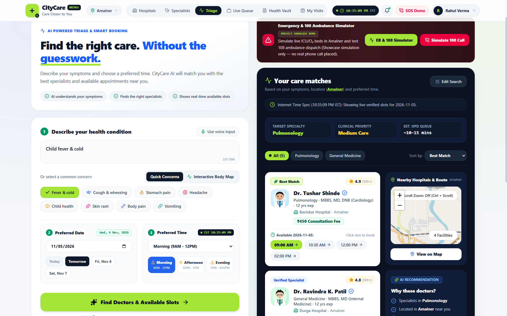
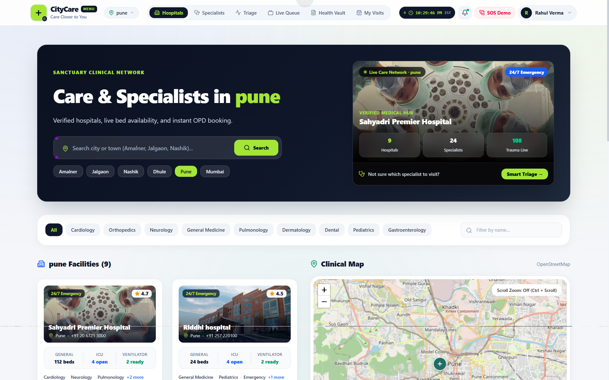
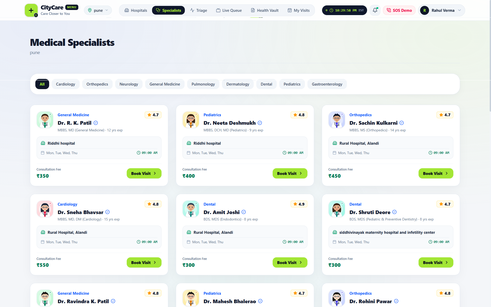
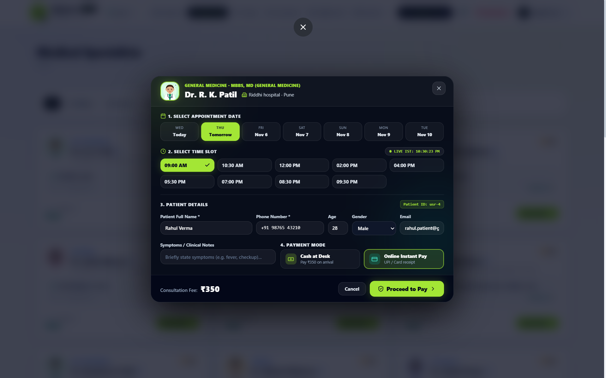
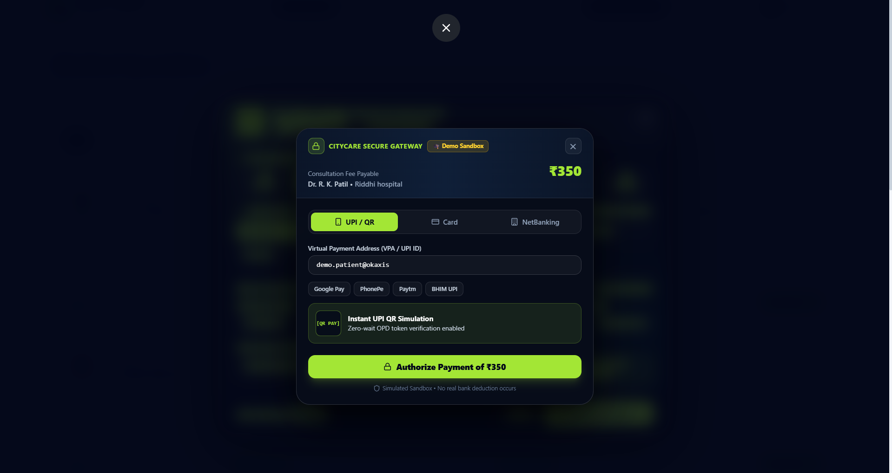

# CityCare — Hospital Appointment & OPD Management System

**Live Project Link:** [https://ais-pre-bxytgppesah33psacacmdl-530948025475.asia-east1.run.app](https://ais-pre-bxytgppesah33psacacmdl-530948025475.asia-east1.run.app)

CityCare is a web application for finding hospitals by city, checking symptoms to find the right medical department, and booking outpatient (OPD) doctor appointments. It includes separate portals for patients, doctors, receptionists, and administrators.

---

## Features

- **Symptom Checker & Body Map:** Enter symptoms in plain text, use voice input, or click on an interactive body map to find the recommended medical specialty and available doctors.
- **City Hospital Search & Map:** Browse hospitals across cities (Amalner, Jalgaon, Nashik, Dhule, Pune, Mumbai, Delhi, Bengaluru, Ahmedabad, Chennai) with live general, ICU, and ventilator bed counts on an OpenStreetMap view.
- **Real-Time IST Slot Booking:** Time slots are validated against Indian Standard Time (`Asia/Kolkata`) so past time slots for the current day cannot be booked.
- **Double-Booking Prevention:** Server-side checks prevent two patients from booking the same doctor at the same time, and prevent a single patient from booking overlapping slots with different doctors.
- **Payment Options:** Supports "Cash at Reception" as well as a demo online payment flow (UPI, QR, Card, NetBanking) and generates a printable OPD appointment slip.
- **Waiting Room Queue Board:** Displays active tokens (`Booked`, `Checked In`, `In Cabin`, `Completed`) with optional voice announcements in English, Hindi, and Marathi.
- **Role-Based Portals:**
  - **Patient Portal:** View upcoming appointments, reschedule or cancel bookings, download appointment slips, and manage records in the Health Vault.
  - **Doctor Portal:** Manage daily patient queue, record vitals (BP, heart rate, SpO2, temperature), write prescriptions, and block unavailable time slots.
  - **Receptionist Portal:** Register walk-in patients, update check-in status, and mark cash payments as collected.
  - **Admin Dashboard:** Add or manage hospitals and doctors, view bed occupancy, and check system audit logs.

---

## Screenshots

### Symptom Triage & Smart Booking


### Hospital Directory & Map View


### Doctors Directory


### Appointment Slot Selection


### Demo Payment Checkout


---

## Tech Stack

- **Frontend:** React 19, TypeScript, Tailwind CSS v4, Lucide Icons, Leaflet (OpenStreetMap)
- **Backend:** Node.js, Express, TSX (`server.ts`)
- **Database:** Local JSON persistence (`data/db.json`)
- **AI / Triage:** Google Gemini API (`@google/genai`) with a local rule-based fallback for symptom matching

---

## Project Structure

```text
├── data/
│   └── db.json                        # JSON storage for users, hospitals, doctors, appointments, and logs
├── public/
│   └── assets/aistudio/               # Project screenshots
├── src/
│   ├── components/
│   │   ├── AdminDashboard.tsx         # Admin panel for hospitals, doctors, and audit logs
│   │   ├── AppointmentSlipModal.tsx   # Printable OPD token slip
│   │   ├── BookingModal.tsx           # Date and IST slot selection modal
│   │   ├── DoctorCard.tsx             # Doctor profile card
│   │   ├── DoctorPortal.tsx           # Doctor cabin console, vitals, and prescriptions
│   │   ├── EmergencyCommandModal.tsx  # 108 ambulance & emergency response simulator
│   │   ├── HospitalCard.tsx           # Hospital details and bed availability card
│   │   ├── HospitalMap.tsx            # Interactive Leaflet map with routing
│   │   ├── InteractiveBodyMap.tsx     # Visual body part selector for symptom triage
│   │   ├── LoginPage.tsx              # Sign-in and role selection screen
│   │   ├── MedicalHistoryVault.tsx    # Patient medical record storage
│   │   ├── Navbar.tsx                 # Top navigation, language toggle (EN/HI/MR), and role switcher
│   │   ├── PatientPortal.tsx          # Patient appointment tracking and history
│   │   ├── PaymentModal.tsx           # Demo UPI, QR, and card payment modal
│   │   ├── ReceptionistPortal.tsx     # Front-desk walk-in registration and queue controls
│   │   ├── SymptomChecker.tsx         # Symptom analyzer and doctor recommendation view
│   │   └── WaitingRoomQueueBoard.tsx  # Live OPD token display board
│   ├── services/
│   │   └── api.ts                     # Frontend API helper functions
│   ├── types/
│   │   └── index.ts                   # TypeScript interfaces
│   ├── utils/
│   │   ├── audio.ts                   # Queue sound and speech synthesis helper
│   │   ├── internetTime.ts            # IST clock calculation and slot validation
│   │   └── translations.ts            # English, Hindi, and Marathi translations
│   ├── App.tsx                        # Main application state and routing
│   └── main.tsx                       # React entry point
├── server.ts                          # Express server and REST API endpoints
├── package.json
└── vite.config.ts
```

---

## How to Run Locally

1. **Clone the repository**
   ```bash
   git clone <your-github-repo-url>
   cd citycare
   ```

2. **Install dependencies**
   ```bash
   npm install
   ```

3. **Set up environment variables (optional)**
   Copy `.env.example` to `.env` and add your `GEMINI_API_KEY` if you want AI-based symptom analysis. The app also works without an API key using its built-in symptom matcher.
   ```bash
   cp .env.example .env
   ```

4. **Start the development server**
   ```bash
   npm run dev
   ```
   The application will run on `http://localhost:3000`.

---

## Live Deployment

You can access the live hosted version here:  
**[https://ais-pre-bxytgppesah33psacacmdl-530948025475.asia-east1.run.app](https://ais-pre-bxytgppesah33psacacmdl-530948025475.asia-east1.run.app)**
